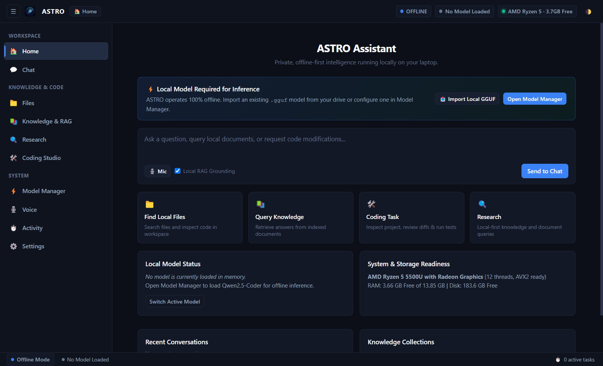
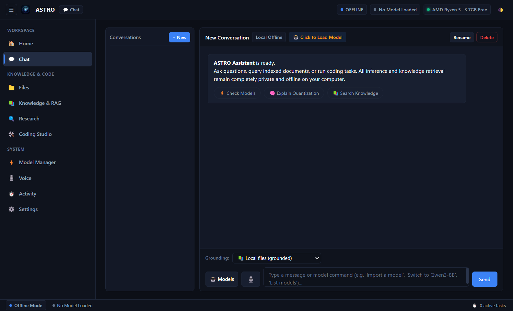
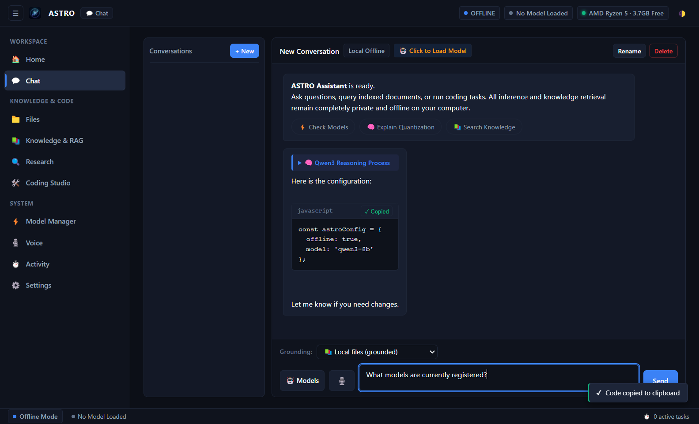
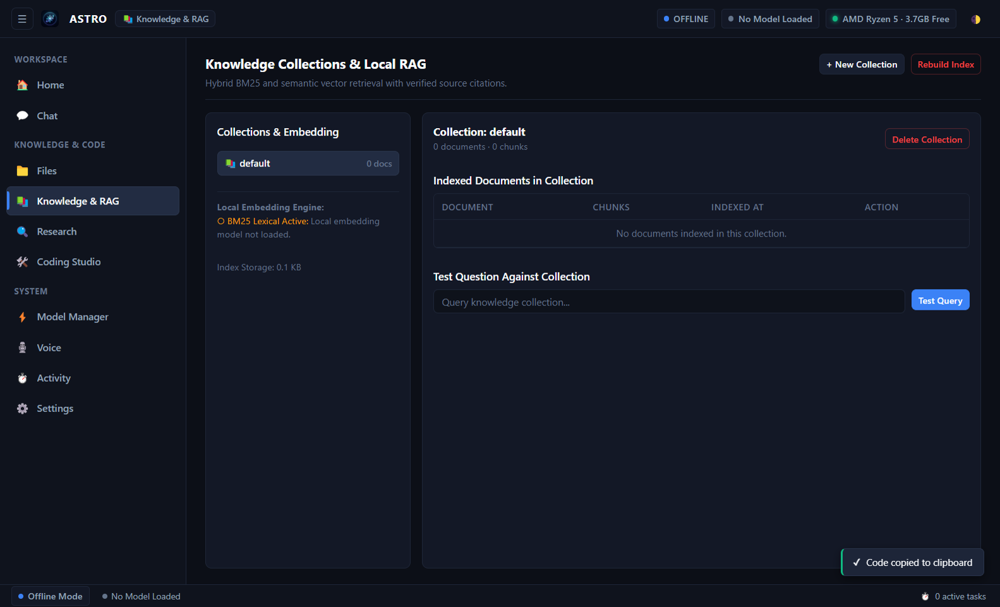
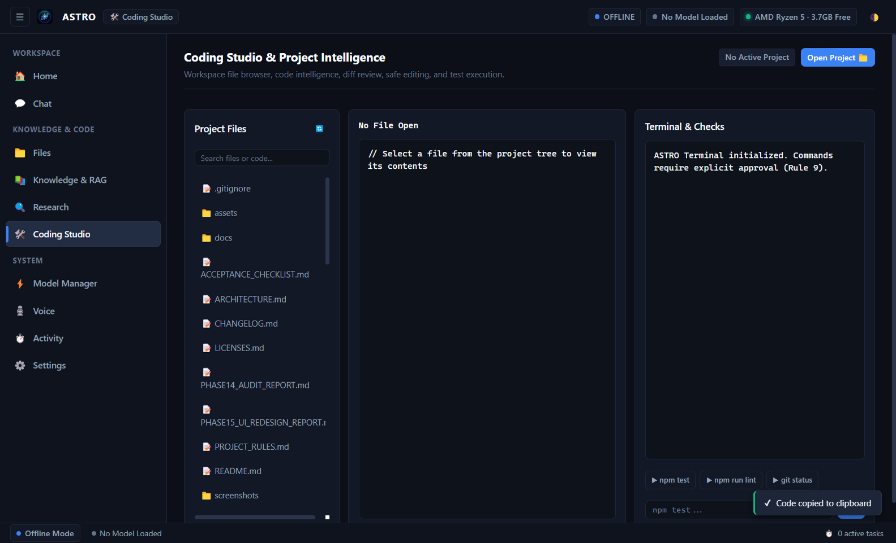
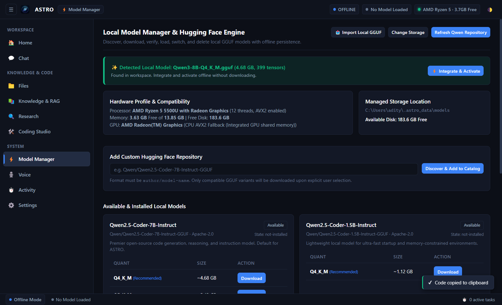

# ASTRO

**Offline-First Native Desktop AI Assistant & Coding Studio for Windows**

ASTRO is an open-source, private-by-default desktop AI assistant and coding environment engineered to run local language models directly on your personal computer. Designed specifically for practical operation on consumer Windows laptops—including AMD Ryzen 5 systems with integrated Radeon graphics—ASTRO performs text generation, code editing, and document question-answering entirely on-device without sending prompts, source code, or private files to external cloud servers.

ASTRO combines native CPU-accelerated GGUF inference (`node-llama-cpp`), a Bring Your Own Model (BYOM) zero-copy architecture, dynamic memory preflight safeguards, local Retrieval-Augmented Generation (RAG) with source citations, a guarded Coding Studio with automatic diff rollbacks, and a Dark Professional desktop interface.

---

## Table of Contents

- [Key Features](#key-features)
- [Application Screenshots](#application-screenshots)
- [System Requirements & Hardware Tiers](#system-requirements--hardware-tiers)
- [Download & Installation](#download--installation)
- [First-Time Model Setup](#first-time-model-setup)
- [Workspaces & Common Workflows](#workspaces--common-workflows)
- [Privacy & Offline Architecture](#privacy--offline-architecture)
- [User Data, Backups & Uninstallation](#user-data-backups--uninstallation)
- [Troubleshooting & Common Issues](#troubleshooting--common-issues)
- [Development, Building & Testing](#development-building--testing)
- [Security Notice & Known Limitations](#security-notice--known-limitations)
- [Documentation Index](#documentation-index)
- [Contributing & Preview Feedback](#contributing--preview-feedback)
- [License](#license)

---

## Key Features

### 1. Local AI Chat & Reasoning
- **Native GGUF Inference:** Runs open-weights models (such as Qwen3-8B and Qwen2.5-Coder-7B) using compiled C++ bindings with multi-threaded AVX2 CPU acceleration.
- **Collapsible Reasoning (`<think>` blocks):** Natively parses and renders internal reasoning steps produced by reasoning models in collapsible thought blocks.
- **Fenced Code Blocks:** Syntax-styled code containers with language tags, line numbers, and one-click copy buttons with toast feedback.
- **Interactive Prompt Starters:** Quick-start chips in empty conversations to test models, quantization, and local search.

### 2. Bring Your Own Model (BYOM) & Memory Preflight
- **Zero-Copy In-Place Registration:** Point ASTRO to `.gguf` files stored on external SSDs, secondary drives, or custom folders without duplicating multi-gigabyte files.
- **Deep GGUF Binary Inspection:** Inspects GGUF v2/v3 magic headers, architecture, tensor counts, and quantization precision without loading weights into RAM.
- **Model Memory Preflight Protection:** Dynamically calculates memory requirements (model weights + context window buffer + engine runtime overhead + OS headroom). Warns users before disk paging occurs and blocks loading if physical RAM is insufficient, unless overridden by explicit user authorization.
- **Single-Model Confinement:** Enforces sequential unloading and loading to prevent simultaneous model loading from overwhelming system memory.

### 3. Local Document Intelligence & Offline RAG
- **Multi-Format Extraction Registry:** Native offline extraction for Markdown (`.md`), Plain Text (`.txt`, `.log`), Code files (`.js`, `.ts`, `.py`, `.rs`, `.c`, etc.), JSON, CSV, PDF documents, and Office files (`.docx`, `.xlsx`, `.pptx`).
- **Hybrid Retrieval:** Combines lexical BM25/TF-IDF keyword search with cosine similarity vector retrieval.
- **Transparent Citations:** Responses grounded in local files provide clickable source filenames and snippet excerpts.
- **Prompt Injection Containment:** Treats document text strictly as untrusted data, preventing retrieved content from hijacking system instructions.

### 4. Guarded Coding Studio
- **Project Tree & Diff Viewer:** Inspect project hierarchies and review unified diffs before applying changes to disk.
- **Automatic Rollback Backups:** Modifying project files creates timestamped `.astro_bak` recovery files for instant restoration.
- **Workspace Confinement:** All file reads, edits, and terminal command executions are strictly restricted to approved workspace directories.
- **Destructive Command Gate:** High-risk actions (such as deletion or recursive commands) require explicit secondary confirmation.

### 5. Desktop Actions, Voice & System Diagnostics
- **Low-Risk Desktop Actions:** Inspect system status and search local files directly through natural language or voice.
- **Voice Input:** Voice transcription interface with speech text cleanup and instant playback interruption.
- **Activity Log:** Real-time task manager tracking model downloads, indexing progress, and system actions with secret redaction.

---

## Application Screenshots

The following genuine screenshots illustrate the ASTRO Dark Professional desktop interface:

| Workspace | Screenshot Preview |
| :--- | :--- |
| **01. Home & Onboarding** |  |
| **02. Local AI Chat** |  |
| **Chat with Code & `<think>` Blocks** |  |
| **04. Local Knowledge & RAG** |  |
| **06. Coding Studio & Diff Viewer** |  |
| **07. Model Manager & BYOM** |  |

---

## System Requirements & Hardware Tiers

ASTRO runs entirely on consumer x86_64 hardware. Because model memory consumption scales with model parameter count and context window length, hardware requirements depend on the model selected:

| Requirement | Minimum (App & 1.5B Models) | Recommended (Qwen3-8B & Coding Studio) |
| :--- | :--- | :--- |
| **Operating System** | Windows 10 (64-bit, Build 19041+) or Windows 11 | Windows 11 (64-bit) |
| **Processor (CPU)** | 4-Core x86_64 with **AVX2** support | AMD Ryzen 5 (Zen 2/3/4) or Intel Core i5/i7 (8th Gen+) |
| **System Memory (RAM)** | **8 GB RAM** (runs Qwen2.5-Coder-1.5B comfortably) | **16 GB RAM** (minimum 12 GB for Qwen3-8B without paging) |
| **Free Storage Space** | 2 GB for Application + 3 GB for 1.5B Model | 2 GB for Application + 10–12 GB for 8B Models (SSD recommended) |
| **Graphics (GPU)** | Integrated Graphics (AMD Radeon / Intel UHD) | Dedicated GPU (optional; CPU AVX2 is natively accelerated) |

### Important Hardware Guidance
- **AVX2 Requirement:** ASTRO's local inference engine requires AVX2 vector extensions. Older CPUs (manufactured before ~2013) without AVX2 cannot run local inference.
- **8 GB RAM Limitation with 8B Models:** `Qwen3-8B-Q4_K_M.gguf` requires ~5.58 GB RAM for weights, context, and engine overhead. Because Windows 11 typically consumes 3.5–4.5 GB RAM, running Qwen3-8B on an 8 GB device leaves insufficient free physical RAM, causing the operating system to page memory to disk. For 8 GB laptops, `Qwen2.5-Coder-1.5B-Instruct` (requiring ~2.0 GB RAM) is strongly recommended for responsive, paging-free inference.
- **Measured Real-World Throughput:** On an AMD Ryzen 5 5500U laptop (6 cores, 12 threads) executing pure CPU AVX2 multi-threading, `Qwen3-8B` achieves approximately **4.40 tokens/second** with a Time to First Token (TTFT) of ~1.42 seconds.

---

## Download & Installation

The latest verified release artifacts are staged in [`dist-release/`](dist-release/):

| Artifact | Type | File Size | SHA-256 Checksum |
| :--- | :--- | :--- | :--- |
| **`ASTRO-Setup-0.1.0.exe`** | NSIS Installer | 368,981,143 bytes | `F325DA5631033BCD9E6BEE14BD801597261858B4E0D9AD4A5C1B6514C352A3FB` |
| **`ASTRO-0.1.0-portable.exe`** | Portable Edition | 368,604,064 bytes | `1FFC8C6B55365B06F27422FA98861BEBDBA3B8509EB8F4873ABA26195550C838` |

### Integrity Verification
To verify the integrity of your downloaded executable before launching, open Windows PowerShell in the download folder:
```powershell
Get-FileHash -Path .\ASTRO-Setup-0.1.0.exe -Algorithm SHA256
```
Compare the resulting hash against `dist-release/SHA256SUMS.txt`.

### Windows Defender SmartScreen Notice
> [!IMPORTANT]
> ASTRO v0.1.0 is currently distributed as an open-source **Restricted Technical Preview** and is not digitally signed with an Authenticode certificate (`NotSigned`).
>
> When launching the installer or portable binary for the first time, Windows Defender SmartScreen may display:
> *"Windows protected your PC — Microsoft Defender SmartScreen prevented an unrecognized app from starting."*
>
> **Technical Preview Users:** If and only if you downloaded the executable from the verified repository release and confirmed that the SHA-256 hash matches the manifest above, you may launch the application by clicking **"More info"** and then selecting **"Run anyway"**. Never bypass security prompts for files obtained from unverified third-party sources.

For complete installation instructions, see the [`INSTALLATION_GUIDE.md`](docs/INSTALLATION_GUIDE.md).

---

## First-Time Model Setup

To keep the application download lightweight (~369 MB), model weights are not bundled into the installer. You connect a `.gguf` format model file on first launch.

### Recommended Model
- **Model:** `Qwen3-8B-Q4_K_M.gguf` (Alibaba Cloud Qwen Team)
- **File Size:** ~4.68 GiB (5,027,783,488 bytes)
- **SHA-256:** `d98cdcbd03e17ce47681435b5150e34c1417f50b5c0019dd560e4882c5745785`
- **Format:** GGUF v3 (ChatML prompt format with native `<think>` reasoning support)

### Connecting a Model
1. **Automatic Detection:** Place your `.gguf` file in your `Downloads` folder, on your `Desktop`, or in `%USERPROFILE%\.astro_data\models\`. When you open ASTRO and navigate to **🤖 Models**, a banner will detect the file. Click **Register & Activate**.
2. **Bring Your Own Model (BYOM):** If your model is on an external drive or custom directory:
   - Navigate to **🤖 Models** and click **Import Local Model (.gguf)**.
   - Select your `.gguf` file in the file picker.
   - ASTRO inspects the header and registers the model **in-place** (zero-copy), referencing the file without duplicating multi-gigabyte weights.
3. **Switching & Unloading:** The topbar pill displays the active model name and status. Switching models safely unloads the previous model before initializing the target model.

For detailed model acquisition instructions, see the [`MODEL_SETUP_GUIDE.md`](docs/MODEL_SETUP_GUIDE.md).

---

## Workspaces & Common Workflows

ASTRO organizes functions into ten specialized workspaces accessible from the sidebar:

- **01. Home:** System status, hardware summary, active model indicator, and quick links.
- **02. Chat:** Multi-turn conversational interface with streaming tokens, code copying, and thought expansion.
- **03. Files:** Local file explorer for inspecting workspace directories and reading source code.
- **04. RAG Knowledge:** Multi-collection document library. Index folders, rebuild lexical/vector indexes, and query with verifiable source citations.
- **05. Web Research:** Local-first research engine with optional, explicitly gated online search.
- **06. Coding Studio:** Safe software development studio with project tree view, unified diff inspector, and guarded terminal runner.
- **07. Model Manager:** Catalog of approved models, local GGUF importer, deep binary inspector, and active model switcher.
- **08. Voice Actions:** Speech interface with local text normalization and wake-word controls.
- **09. Activity Log:** Audit log tracking model loads, indexing jobs, and execution history with secret redaction.
- **10. Settings:** Theme toggle, workspace boundaries, model storage directory, and privacy switches.

---

## Privacy & Offline Architecture

ASTRO is built on an **offline-first, private-by-default** architecture:

1. **Local Computation:** All text inference, document chunking, embeddings, vector indexing, file reading, diff generation, and command executions occur exclusively on your local CPU and storage.
2. **Offline-First Policy:** The application default setting enforces `offlineOnly: true`. In this mode, outbound network calls are blocked immediately at the service layer without opening network sockets.
3. **Optional Network Features:**
   - **Model Discovery:** Allows querying Hugging Face model metadata when explicitly invoked by the user and permitted in Settings.
   - **Web Research:** Queries public search APIs only when explicitly enabled by the user (`allowOnline: true`) and permitted in Settings.
4. **Zero Telemetry:** ASTRO contains no analytics trackers, crash-reporting beacons, or background telemetry.
5. **Runtime Sandboxing:** The Electron renderer runs with `sandbox: true`, `contextIsolation: true`, `nodeIntegration: false`, strict Content Security Policy (`default-src 'self'`), navigation interception, and window-open denial.

For full architectural details, see the [`PRIVACY_STATEMENT.md`](docs/PRIVACY_STATEMENT.md).

---

## User Data, Backups & Uninstallation

All persistent user data is decoupled from application executables and stored in your Windows user profile:

```
%USERPROFILE%\.astro_data\
├── models\                     # Model registry and metadata
├── databases\
│   ├── conversations\          # Conversation history (JSON)
│   └── rag-index\              # Vector embeddings and lexical indexes
├── documents\
│   └── extraction-cache\       # Cached text extractions
├── settings\
│   └── astro-settings.json     # User preferences and privacy flags
└── logs\
    └── astro-audit.log         # Secret-masked activity logs
```

### Backing Up Data
To create a complete backup of your conversations, settings, and indexes, copy the `%USERPROFILE%\.astro_data\` directory to a safe location.

### Uninstallation Behavior
The NSIS uninstaller (`Uninstall ASTRO.exe`) removes application executables and shortcuts from `%LOCALAPPDATA%\Programs\ASTRO\` but deliberately preserves `%USERPROFILE%\.astro_data\` (`deleteAppDataOnUninstall: false`). Your chat history, document embeddings, and model files will remain intact unless you choose to delete `%USERPROFILE%\.astro_data\` manually.

---

## Troubleshooting & Common Issues

| Problem | Cause | Solution |
| :--- | :--- | :--- |
| **SmartScreen "Unrecognized App" Warning** | Binary is an unsigned technical preview (`NotSigned`). | Verify SHA-256 checksum with `Get-FileHash`, click **More info**, then **Run anyway**. |
| **"Memory Preflight Block" on Load** | Selected model exceeds physical RAM capacity. | Select a smaller model (such as `Qwen2.5-Coder-1.5B`), reduce context length, or confirm the explicit override in the preflight dialog. |
| **"Memory Paging Warning" / Slow Inference** | Free RAM is lower than model requirement; OS is paging to disk. | Close background applications (browser tabs, IDEs) or switch to a lightweight model. |
| **"Model file not found" / Missing File** | Model was moved, renamed, or on a disconnected drive. | Reconnect the drive or click **Repair Path** in Model Manager to re-link the file. |
| **Inference Crash on Old CPU** | CPU lacks required AVX2 vector extensions. | ASTRO requires an AVX2-compatible processor. Check CPU specs using `scripts/check-hardware.js`. |

For additional troubleshooting scenarios, see [`TROUBLESHOOTING.md`](docs/TROUBLESHOOTING.md).

---

## Development, Building & Testing

### Prerequisites
- Windows 10/11 (64-bit)
- Node.js 20.x or 22.x
- C++ Build Tools (Visual Studio 2022 Build Tools with Desktop development with C++)

### Setup & Run
```cmd
# Install dependencies
npm.cmd install

# Check local hardware compatibility
npm.cmd run check-hw

# Launch ASTRO in development mode
npm.cmd start
```

### Running Automated Tests
ASTRO maintains an automated regression test suite covering all subsystems (Storage, Hardware, Verification, RAG, Security, Coding Studio, Lifecycle, BYOM, UI, and Memory Preflight):
```cmd
# Run all 18 test suites (158 automated tests)
npm.cmd test
```
*Current Test Status:* **158 passed, 0 failed, 0 skipped (100% pass rate)**.

### Building Release Packages
```cmd
# Compile both NSIS Installer and Portable Executable
npm.cmd run build

# Generate and verify artifact checksums
npm.cmd run generate:checksums
npm.cmd run verify:checksums
```

---

## Security Notice & Known Limitations

1. **Technical Preview Status:** ASTRO v0.1.0 is currently classified as a **Restricted Technical Preview**. It has been validated through 158 automated regression tests and real hardware inference on an AMD Ryzen 5 laptop, but has not yet undergone wide-scale consumer field testing.
2. **Authenticode Code Signing:** Binaries are currently unsigned (`NotSigned`). Commercial Authenticode code signing is planned before any general consumer distribution.
3. **Inference Performance:** CPU inference provides steady interactive generation (~4.4 tokens/sec for 8B models), but will not match the latency of dedicated datacenter GPU clusters.
4. **Clean-Machine VM Validation:** Clean-machine installation testing was verified on the host system without developer tools, but has not yet been conducted on a bare-metal isolated VM due to workstation sandbox constraints.

---

## Documentation Index

- [`INSTALLATION_GUIDE.md`](docs/INSTALLATION_GUIDE.md) — Detailed Windows installation, verification, and launch instructions.
- [`MODEL_SETUP_GUIDE.md`](docs/MODEL_SETUP_GUIDE.md) — GGUF format overview, model acquisition, and BYOM registration.
- [`RELEASE_NOTES.md`](docs/RELEASE_NOTES.md) — v0.1.0 release notes, changelog summary, and benchmark results.
- [`PRIVACY_STATEMENT.md`](docs/PRIVACY_STATEMENT.md) — Offline boundary disclosure, data storage, and security model.
- [`TROUBLESHOOTING.md`](docs/TROUBLESHOOTING.md) — Recovery procedures, path repairs, and performance tuning.
- [`LICENSES.md`](docs/LICENSES.md) — Open-source software licenses and model attributions.
- [`CHANGELOG.md`](docs/CHANGELOG.md) — Comprehensive development phase history.
- [`PREVIEW_FEEDBACK_TEMPLATE.md`](docs/PREVIEW_FEEDBACK_TEMPLATE.md) — Bug reporting and feedback submission form.
- [`PHASE27_PRE_DISTRIBUTION_VERIFICATION.md`](docs/PHASE27_PRE_DISTRIBUTION_VERIFICATION.md) — Latest pre-distribution audit report and owner gate.

---

## Contributing & Preview Feedback

Feedback from technical preview testers is vital for ASTRO's ongoing refinement. If you encounter an issue, crash, or unexpected behavior:

1. Review [`docs/TROUBLESHOOTING.md`](docs/TROUBLESHOOTING.md) to see if the issue is already known.
2. Complete the [`PREVIEW_FEEDBACK_TEMPLATE.md`](docs/PREVIEW_FEEDBACK_TEMPLATE.md) with your Windows version, CPU, RAM, and model details.
3. Submit your report to the project issue tracker.

---

## License

- **Application:** ASTRO is open-source software licensed under the [MIT License](docs/LICENSES.md).
- **Default Models:** Qwen language models are developed by Alibaba Cloud and licensed under the [Apache License 2.0](https://huggingface.co/Qwen).
- **Inference Engine:** `llama.cpp` and `node-llama-cpp` are licensed under the MIT License.
