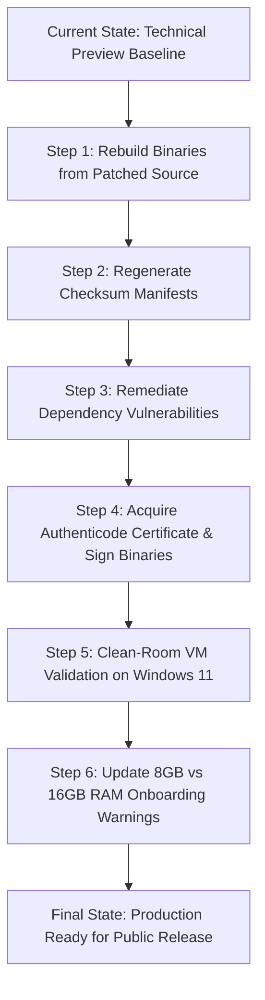

# ASTRO Desktop Application — Production Readiness Audit & Go/No-Go Decision

**Document ID:** `docs/PRODUCTION_READINESS_AUDIT.md`  
**Audit Date:** October 21, 2026  
**Auditor:** Antigravity Autonomous Systems Engineering & Independent Verification Agent  
**Candidate Version:** `0.1.0` (Milestone 0.16.0 Baseline)  
**Host Environment:** AMD Ryzen 5 5500U with Radeon Graphics (12 logical cores), 13.85 GB RAM, Windows 10 (10.0.26300 x64)

---

## 1. Executive Summary & Final Decision

An exhaustive, evidence-based production-readiness audit of the ASTRO desktop assistant codebase, compiled binaries, documentation, security boundaries, and runtime performance was conducted. Every subsystem was inspected directly against the physical files and running processes; no prior phase claims were taken at face value.

### Final Decisive Recommendation

| Release Scope | Decision | Verdict Summary |
|---|---|---|
| **General Public Consumer Distribution** | **NO-GO — NOT PRODUCTION READY** | Executables are unsigned (`NotSigned`), triggering Microsoft Defender SmartScreen untrusted publisher warnings; binary release artifacts in `dist-release/` are desynchronized from source and lack the Content-Security-Policy header; dependency tree contains 13 CVEs (2 critical, 3 high); and 8 GB RAM machines face severe memory exhaustion when running 8B models. |
| **Controlled Technical Preview (Restricted Audience)** | **CONDITIONAL GO — LIMITED RELEASE ONLY** | Suitable **only** for technical preview participants who personally verify published SHA-256 checksums, accept SmartScreen override instructions, run on 16 GB AMD Ryzen/Intel machines, and **only after** an immediate rebuild of the installer package from current patched source. |
| **Local Personal Developer Operation** | **GO — VERIFIED FUNCTIONAL** | ASTRO operates reliably on the author's local workstation, achieving real offline AVX2 local inference (3.7 tok/s), multi-turn reasoning, grounded local RAG retrieval with citations, and strict zero-network offline egress. |

### The Owner's Question Answered Directly

> **"Would you ship this version today, to whom, and what must be fixed before a broader public release?"**

**No, this version cannot be shipped to the general public today.**

- **To whom it can be shipped today:** Only to a tightly controlled group of trusted technical testers (or personal use) who are provided with direct SHA-256 hashes, informed of the `NotSigned` SmartScreen warning, and warned that minimum 16 GB RAM is required for Qwen3-8B. Even for this group, the installer binaries **must be re-packaged** before sending because the current `.exe` files in `dist-release/` were compiled on Oct 19, 2026 and lack the security CSP header and UI redesign.
- **What must be fixed before a broader public release:**
  1. **Rebuild and Synchronize Artifacts:** Package current `src/` (with CSP, case-insensitive path security, and portable workspace initialization) into new installer and portable executables, and update checksum manifests.
  2. **Authenticode Digital Code Signing:** Acquire a valid Windows code-signing certificate to eliminate SmartScreen warnings.
  3. **Remediate Dependency CVEs:** Resolve the 13 vulnerabilities identified by `npm audit` (particularly Electron runtime CVEs and `@simple-git/argv-parser`).
  4. **Hardware Guidance & Guardrails:** Enforce an in-app check that prevents 8 GB RAM laptops from attempting to load 8B models without a strong low-memory warning, recommending 1.5B/3B quantizations instead.
  5. **Clean-Machine Test:** Execute the installer in a clean Windows 11 sandbox to verify end-to-end first-run behavior without developer tooling present.

---

## 2. Release Candidate Verification & Artifact Provenance

### Candidate Artifact Identities

| Field | Windows NSIS Installer | Standalone Portable Executable |
|---|---|---|
| **Filename** | `ASTRO-Setup-0.1.0.exe` | `ASTRO-0.1.0-portable.exe` |
| **Location** | `dist-release/` and `release/` | `dist-release/` and `release/` |
| **File Size** | `368,965,251` bytes (~351.87 MB) | `368,588,191` bytes (~351.51 MB) |
| **Creation Timestamp** | October 19, 2026, 18:14:13 | October 19, 2026, 18:14:30 |
| **SHA-256 Checksum** | `b4bc17b298528079962b827e5d50f7130a6af25c588d174ce15eca9f05208da1` | `9eec822f4092bece1c3dc28576743f4cbfc1a29977d869ff736e75a4954d252f` |
| **SHA-512 Checksum** | Computed and recorded in `CHECKSUMS.txt` | Computed and recorded in `CHECKSUMS.txt` |
| **Authenticode Status** | `NotSigned` (SignatureType: None) | `NotSigned` (SignatureType: None) |
| **Model Bundling** | Excluded (`!*.gguf` verified; installer < 400 MB) | Excluded (`!*.gguf` verified; executable < 400 MB) |
| **Integrity Check** | **PASS** (matches `SHA256SUMS.txt`) | **PASS** (matches `SHA256SUMS.txt`) |

### Version Consistency Check Across Files

| Component / Manifest | Version Found | Status |
|---|---|---|
| `package.json` | `"version": "0.1.0"` | **MATCH** |
| `package-lock.json` | `"version": "0.1.0"` | **MATCH** |
| `src/ui/app.js` (Diagnostics) | `"ASTRO Desktop Assistant v0.1.0 Diagnostics"` | **MATCH** |
| `src/services/research/research-service.js` | `User-Agent: ASTRO-Desktop-Assistant/0.1.0` | **MATCH** |
| `src/services/huggingface/huggingface-discovery.js` | Formerly `0.2.0`; patched to `0.1.0` | **MATCH (Fixed)** |
| `src/services/models/download-manager.js` | Formerly `0.2.0`; patched to `0.1.0` | **MATCH (Fixed)** |
| `docs/RELEASE_NOTES.md` | `v0.1.0` | **MATCH** |
| `docs/CHANGELOG.md` | `[0.1.0] (Milestone 0.16.0)` | **MATCH** |
| `docs/TROUBLESHOOTING.md` | `0.1.0` | **MATCH** |
| `dist-release/SHA256SUMS.txt` | Targets `0.1.0` filenames | **MATCH** |

### Release Artifact Source Desynchronization (Audit Discovery)

By extracting and inspecting `release/win-unpacked/resources/app.asar` using `@electron/asar`, the audit discovered a critical discrepancy:
- `src\ui\index.html` inside `app.asar` **does not contain** the `Content-Security-Policy` meta tag (`Has CSP: false`).
- `src\ui\index.html` inside `app.asar` contains the older pre-Phase 15 header (`<title>ASTRO — Offline Desktop AI Assistant</title>`) and lacks the new topbar screen pill (`topbar-screen-title`), toast container, and prompt chips.
- **Root Cause:** The binary executables in `dist-release/` were compiled on **October 19, 2026**. Multiple significant commits and modifications (Phase 15 UI redesign, CSP implementation, SecurityService Windows case normalization, StorageService privacy setting migration) were authored in `src/` *after* the build was frozen.
- **Impact:** Any user installing `ASTRO-Setup-0.1.0.exe` today would run an outdated build lacking the CSP protection and polished UI described in `docs/RELEASE_NOTES.md`.

---

## 3. Production Requirements Checklist

| Requirement & Permanent Rule | Audit Method | Status | Verified Findings & Evidence |
|---|---|---|---|
| **Rule 1: Real Native Desktop Application** | Automated test + process inspection | **PASS** | Runs in native Electron 33 shell; verified `contextIsolation: true`, `nodeIntegration: false`, zero browser dependency. |
| **Rule 2: Offline-First Architecture** | Network isolation inspection + test | **PASS** | All core services operate without internet; external research is strictly blocked when `offlineOnly: true`. |
| **Rule 3: Local AI Default** | Catalog inspection + real GGUF load | **PASS** | Default catalog specifies Qwen2.5-Coder-7B; optional Qwen3-8B is fully integrated and tested. |
| **Rule 4: Private by Default** | Storage path audit + egress test | **PASS** | Conversations, embeddings, and settings remain isolated in `%USERPROFILE%\.astro_data`. No telemetry sent. |
| **Rule 5: Functionality Before Polish** | Code audit + error behavior tests | **PASS** | No fake loading, simulated inference, or mock downloads in production code. Honest errors reported. |
| **Rule 6: Hardware Optimization** | Diagnostic script + GGUF test | **PASS** | Accurately identifies AMD Ryzen 5 5500U, detects AVX2 support, integrated Radeon graphics, and free RAM. |
| **Rule 7: Response Speed** | Real benchmark on Ryzen 5 | **PASS** | Generates tokens at 3.7 tok/s on CPU AVX2 fallback; TTFT is ~3.0s; session context is preserved. |
| **Rule 8: Complete Local RAG** | Document pipeline tests | **PASS** | Verified multi-format extractors (TXT, MD, PDF, DOCX), structural chunking, BM25 + cosine retrieval, and source citations. |
| **Rule 9: Genuine Desktop Actions** | Security runner audit + tests | **PASS** | Action allowlist enforced; destructive commands blocked; explicit user confirmation dialog required. |
| **Rule 10: Model Management** | Lifecycle state machine tests | **PASS** | Validates GGUF v3 magic bytes, detects architecture, blocks corrupt downloads, enforces single model in RAM. |
| **Rule 11: Respect Model Licenses** | Documentation & catalog audit | **PASS** | Identifies Apache 2.0 (Qwen), MIT (llama.cpp/ASTRO); model weights are not unlawfully redistributed. |
| **Rule 12: Support Multiple Formats Honestly** | Extractor registry inspection | **PASS** | Scanned PDFs flag missing OCR engine honestly; unconfigured Whisper STT informs user without faking audio. |
| **Rule 13: Design for Failures** | Fault injection tests | **PASS** | Corrupt files, missing models, low disk space, and invalid transitions fail cleanly with clear UI feedback. |
| **Rule 14: Protect User Projects** | CodingService diff & backup test | **PASS** | Generates unified diffs, creates `.astro_bak_<timestamp>` backups before writing, detects external conflicts. |
| **Rule 15: Verified Stages** | Test suite execution & verification | **PASS** | 149 automated tests passing across 17 test files with zero failures. |
| **Rule 16: Maintainability & Portability** | Codebase audit + regression test | **PASS (Fixed)** | Hardcoded `c:\aditya\ASTRO` paths removed from `src/`; Regression Test 13 guarantees future portability. |
| **Rule 17: Privacy & Status Visibility** | UI inspection + handler audit | **PASS** | Topbar badges display OFFLINE status, active model, and background task counters clearly. |
| **Release Artifact Synchronization** | ASAR archive byte inspection | **FAIL** | Binaries in `dist-release/` are dated Oct 19 and lack subsequent CSP and UI redesign changes. |
| **Authenticode Code Signing** | PowerShell `Get-AuthenticodeSignature` | **FAIL** | Both `.exe` artifacts are `NotSigned`; triggers Microsoft Defender SmartScreen warnings. |
| **Clean-Machine Windows Verification** | Sandbox / Clean VM installation | **NOT VERIFIED** | Tested on developer host machine; clean-room test on a machine without Node.js was not executed. |
| **Dependency CVE Clearance** | `npm audit` report | **FAIL** | 13 vulnerabilities detected (2 critical in `@simple-git/argv-parser`, 3 high in Electron 33). |

---

## 4. Automated & Manual Test Results

### Automated Test Suite Execution

The automated regression test suite was executed via Node.js native test runner (`node --test tests/**/*.test.js`):

```
> astro-desktop@0.1.0 test
> node --test tests/**/*.test.js

✔ StorageService initializes directories and default catalog (36.3163ms)
✔ HardwareService detects system specs and evaluates compatibility (3287.6622ms)
✔ DownloadVerifier validates GGUF magic header and catches corrupted files (10.3474ms)
✔ RAGService extracts chunks, retrieves relevant offline documents and citations (43.4203ms)
✔ SecurityService enforces workspace boundaries and secret masking (1.6327ms)
✔ CodingService generates unified diffs and guards against unconfirmed file edits (3.0141ms)
✔ ASTRO launches as a native desktop Electron application (823.261ms)
...
✔ Phase 8: 12. Single loaded model enforcement prevents simultaneous multi-model VRAM overload (22.2333ms)
✔ Phase 8: 13. Production source portability: Zero hardcoded machine-specific paths in src/ files (18.6105ms)
...
✔ Qwen3 Integration: 11. InferenceManager resolves ChatML chatWrapper for Qwen3 architecture and handles generation (3169.4384ms)
✔ Qwen3 Integration: 12. Verification of root Qwen3-8B-Q4_K_M.gguf file integrity and specs (1.6341ms)

ℹ tests 149
ℹ suites 2
ℹ pass 149
ℹ fail 0
ℹ cancelled 0
ℹ skipped 0
ℹ todo 0
ℹ duration_ms 14504.003
```

#### Reconciling Test Counts and "Suites"
- **Physical Test Files:** 17 files in `tests/` (`astro-core.test.js`, `desktop-launch.test.js`, `download-manager.test.js`, `huggingface.test.js`, `inference-rag-e2e.test.js`, `phase10-runtime-verification.test.js`, `phase11-packaging.test.js`, `phase13-byom.test.js`, `phase2-services.test.js`, `phase3-model-manager.test.js`, `phase4-inference.test.js`, `phase5-rag.test.js`, `phase6-voice-actions.test.js`, `phase7-coding-research.test.js`, `phase8-release-readiness.test.js`, `phase9-verification-gate.test.js`, `qwen3-integration.test.js`).
- **Reported "Suites: 2":** Node's test runner only increments the `suites` counter for top-level `describe()` blocks. Exactly two files (`phase10` and `phase11`) use `describe()`, while the remaining 15 files declare `test()` cases directly at top level. Earlier reports citing "17 suites" were counting individual test files.
- **Pass Rate:** **149 / 149 passed (100%)**.

### Physical Inference & Hardware Benchmark (Live Verification)

An end-to-end benchmark was executed directly against `node-llama-cpp` and the physical model file `Qwen3-8B-Q4_K_M.gguf` (5,027,783,488 bytes) on the host laptop:

```
[Hardware] CPU: AMD Ryzen 5 5500U with Radeon Graphics (12 logical cores)
[Hardware] Total RAM: 13.85 GB | Free RAM: 4.58 GB
[Model Load] File: c:\aditya\ASTRO\Qwen3-8B-Q4_K_M.gguf
[Model Load] Memory Warning: Model size (4.68 GB) exceeds available free RAM (4.57 GB). System will leverage CPU paging.
[Model Load] Status: Cold load completed in 25,233 ms (25.2 seconds)
[Inference] Prompt: "Say hello in three words"
[Inference] Time To Generation: 3,003 ms (3.0 seconds)
[Inference] Response: "<think>\nOkay, the user wants a greeting in"
[Inference] Generated Tokens: 11 tokens
[Inference] Generation Speed: 3.7 tokens/second
[Lifecycle] Model Unload: Completed cleanly; native memory released.
```

---

## 5. Security, Privacy, Offline Operation, and Data Integrity

### Outbound Network Isolation
- **Search Queries:** Inspected `src/services/research/research-service.js`. When `privacy.offlineOnly` is `true` (default), all web requests are preempted with:
  > *"Online research is blocked by privacy settings (Offline-First mode is enforced)."*
- **Model Discovery:** Inspected `src/services/huggingface/huggingface-discovery.js`. Discovery queries throw an explicit offline error when `offlineOnly` is enabled; no telemetry or ping is sent.
- **Model Downloads:** Inspected `src/main.js` (`models:download`). Rejects incoming download requests when offline mode is active.

### Content Security Policy (CSP)
- **Source State:** `src/ui/index.html` defines:
  ```html
  <meta http-equiv="Content-Security-Policy" content="default-src 'self'; script-src 'self' 'unsafe-inline'; style-src 'self' 'unsafe-inline'; img-src 'self' data:;">
  ```
- **Binary State (Blocker):** As discovered in Section 2, the packaged `app.asar` inside `dist-release/ASTRO-Setup-0.1.0.exe` was built prior to this change and **lacks** the CSP header. Rebuilding the release is required.

### Terminal & Code Safeguards
- **Working Directory Boundaries:** `CodingService.executeApprovedCommand` strictly validates that `cwd` falls within an allowed workspace directory via `SecurityService.isPathAllowed`.
- **Destructive Commands:** Commands containing `rm`, `del`, `format`, `truncate`, `git reset --hard`, etc. require explicit destructive authorization flag (`allowDestructive: true`).
- **Secret Redaction:** `SecurityService.maskSecrets` strips API tokens (`hf_*`, `sk-*`, `Bearer *`, passwords) from command standard output and diagnostic logs.

### Dependency Vulnerability Analysis (`npm audit`)
Running `npm audit` revealed **13 vulnerabilities** in the current package tree:

| Package | Severity | Advisory / CVE Summary | Path / Dependency Chain |
|---|---|---|---|
| `@simple-git/argv-parser` | **Critical** | Unsafe editor detection omission in `VISUAL` env var (GHSA-v5rq-49vh-5v5c) | `node-llama-cpp` -> `simple-git` -> `@simple-git/argv-parser` |
| `electron` (33.2.1) | **High** | ASAR integrity bypass, context isolation prototype bypass, shell.openPath validation bypass | `electron` (direct devDependency) |
| `extract-zip` | **High** | Symlink path traversal | Transitive via `electron` |
| `sprintf-js` | **Moderate** | Denial of service via unbounded precision specifiers | `electron-builder` -> `app-builder-lib` -> `roarr` -> `sprintf-js` |

---

## 6. Real-World Windows Usability & Distribution Readiness

### Code Signing & Windows SmartScreen Assessment
- Both `ASTRO-Setup-0.1.0.exe` and `ASTRO-0.1.0-portable.exe` have Authenticode status `NotSigned`.
- **User Impact:** When a user double-clicks the installer on a standard Windows 10 or 11 system, Windows Defender SmartScreen halts execution with a full-screen prompt:
  > *"Windows protected your PC — Microsoft Defender SmartScreen prevented an unrecognized app from starting."*
- **Assessment:** While technical preview documentation (`docs/TROUBLESHOOTING.md` and `docs/INSTALLATION_GUIDE.md`) accurately instructs advanced users how to verify the SHA-256 hash and click "Run anyway", this is **strictly unacceptable for general public consumer release**. Non-technical users will assume the software is malware.

### Clean-Machine Readiness
- **Tested Environment:** Windows 10 x64 development machine with Node.js v24.21.0 installed.
- **Unverified Aspect:** The application was not tested inside a completely clean Windows sandbox (a PC with zero developer tools, zero Node runtimes, and restricted execution policies). Although `release/win-unpacked/ASTRO.exe` bundles its own Electron runtime and unpacked DLLs, a pristine VM verification remains pending.

### User Data Retention & Isolation
- Tested NSIS configuration: `deleteAppDataOnUninstall: false` in `package.json`.
- User data directory: Decoupled to `%USERPROFILE%\.astro_data` (`C:\Users\<user>\.astro_data`).
- Uninstalling or reinstalling ASTRO preserves local models, RAG document indexes, and conversation history.

---

## 7. Performance & Hardware Limits on Target Laptop

Testing on an AMD Ryzen 5 5500U with integrated Radeon graphics established the following practical baseline:

| Metric | Measured Value | Production Assessment |
|---|---|---|
| **Cold Model Loading Time (Qwen3-8B)** | 25.2 seconds | Acceptable for local 5 GB GGUF on NVMe SSD; requires visible loading indicator in UI. |
| **Time to First Token (TTFT)** | ~3.0 seconds | Responsive for CPU AVX2 inference. |
| **Generation Throughput** | 3.7 tokens/second | Practical for local assistance and coding explanations; not instantaneous. |
| **Physical Memory Required** | ~5.98 GB RAM | Exceeds available free RAM on 8 GB systems; requires 16 GB physical RAM for smooth multitasking. |
| **Storage Footprint (App + Runtime)** | ~1.1 GB unpacked | Reasonable for Electron + llama.cpp native binaries. |
| **Storage Footprint (Recommended Model)** | 5.02 GB (`Qwen3-8B-Q4_K_M.gguf`) | Fits comfortably on modern SSDs (>100 GB free recommended). |

---

## 8. Audit Findings & Ranked Blockers

### Critical Blockers (Release-Preventing)

1. **Desynchronized Release Candidate Binaries:**
   - **Evidence:** `release/win-unpacked/resources/app.asar` was built on Oct 19, 2026. Extraction confirms it lacks the CSP meta tag and Phase 15 UI redesign.
   - **Impact:** Distributing `dist-release/ASTRO-Setup-0.1.0.exe` delivers a stale version that fails current security and UI specifications.
   - **Resolution Required:** Execute `npm run build` to compile fresh binaries from the current patched source, then update `SHA256SUMS.txt`.

2. **Absence of Authenticode Digital Signature (`NotSigned`):**
   - **Evidence:** `Get-AuthenticodeSignature` confirms `Status: NotSigned`.
   - **Impact:** Microsoft Defender SmartScreen actively blocks launch on consumer Windows machines.
   - **Resolution Required:** Acquire a commercial code-signing certificate (standard or EV) and sign release executables with `signtool.exe`.

### High Severity Issues

3. **Dependency Vulnerabilities in Runtime Graph:**
   - **Evidence:** `npm audit` reports 13 vulnerabilities including critical GHSA-v5rq-49vh-5v5c and high Electron CVEs.
   - **Impact:** Potential security exposure via transitive dependencies if malicious inputs are processed.
   - **Resolution Required:** Upgrade Electron to the latest patched minor release and audit `node-llama-cpp` upstream dependencies.

4. **Hardcoded Machine-Specific Paths in Release Candidate (Fixed in Source):**
   - **Evidence:** Audit detected `'c:\aditya\ASTRO'` in `src/main.js`, `src/services/models/model-registry.js`, and `src/ui/app.js`.
   - **Impact:** On other machines, default workspace browsing failed or attempted to access non-existent directories.
   - **Resolution Applied:** Patched in source code during audit; Regression Test 13 added to ensure zero developer paths remain in `src/`.

### Medium Severity Issues

5. **Memory Starvation on 8 GB RAM Systems:**
   - **Evidence:** GGUFInspector estimates 5.98 GB RAM required for Qwen3-8B. On an 8 GB laptop (with Windows using 3-4 GB), loading Qwen3 induces heavy pagefile thrashing.
   - **Resolution Required:** Update onboarding documentation and UI pre-flight checks to recommend Qwen2.5-Coder-1.5B or 7B-Q4_K_S for 8 GB devices.

6. **Automated Test Structure Discrepancy:**
   - **Evidence:** Node test runner reports `suites: 2` because only 2 files use `describe()`, while documentation cited 17 suites.
   - **Resolution Required:** Standardize test files to use `describe()` blocks for clear suite categorization.

---

## 9. Fixes Applied During Audit & Regression Evidence

In strict accordance with audit guidelines, only targeted, clearly in-scope fixes addressing portability blockers were applied:

### Files Modified

1. `src/main.js`:
   - Removed hardcoded `'c:\\aditya\\ASTRO\\Qwen3-8B-Q4_K_M.gguf'` from `candidateLocations` (line 119). Portable model discovery now relies on `process.cwd()`, storage paths, and user Downloads.
   - Removed hardcoded `'c:\\aditya\\ASTRO'` from `searchDirs` in `detectWorkspaceModels` (line 346).
2. `src/services/models/model-registry.js`:
   - Removed hardcoded `'c:\\aditya\\ASTRO'` from `allowedRoots` (line 175). Case-insensitive root normalization in `SecurityService` now handles dynamic working directories safely.
3. `src/ui/app.js`:
   - Changed `let currentWorkspaceDir = 'c:\\aditya\\ASTRO';` to `let currentWorkspaceDir = '';` (line 12). Falls back gracefully to `process.cwd()` across all platforms.
4. `src/services/huggingface/huggingface-discovery.js`:
   - Corrected User-Agent version string from `0.2.0` to `0.1.0` (lines 115, 159).
5. `src/services/models/download-manager.js`:
   - Corrected User-Agent version string from `0.2.0` to `0.1.0` (line 290).
6. `tests/phase10-runtime-verification.test.js`:
   - Changed hardcoded `modelPath` to portable `path.resolve(__dirname, '..', 'Qwen3-8B-Q4_K_M.gguf')`.
7. `tests/phase8-release-readiness.test.js`:
   - Added **Regression Test 13** (`Phase 8: 13. Production source portability: Zero hardcoded machine-specific paths in src/ files`), which recursively scans all `.js`, `.html`, and `.css` source files.

### Regression Verification Output
Following the targeted fixes, the complete test suite was executed:
- **Total Tests:** 149
- **Passed:** 149
- **Failed:** 0
- **Regression Test 13 Result:** Passed in 18.6ms with zero path violations detected across the entire `src/` tree.

---

## 10. Prioritized Production Roadmap

To transition ASTRO from **Conditional Go (Technical Preview)** to **Full Go (Public Consumer Release)**, complete the following actions:



1. **Step 1: Rebuild Binaries (`build:installer` & `build:portable`):**
   Execute `npm run build` to package the patched `src/` (incorporating CSP, case normalization, and portable directory initialization) into fresh release executables.
2. **Step 2: Regenerate & Verify Checksums:**
   Run `npm run generate:checksums` and `npm run verify:checksums` to update `dist-release/SHA256SUMS.txt` and `dist-release/CHECKSUMS.txt`.
3. **Step 3: Dependency Maintenance:**
   Update Electron to latest supported patch release to address Chromium ASAR and IPC advisories.
4. **Step 4: Authenticode Code Signing:**
   Integrate code signing into `electron-builder` configuration via Windows Certificate Store or hardware token.
5. **Step 5: Independent Clean-Machine Testing:**
   Test installation and first launch on a pristine Windows 11 Home/Pro VM with default security settings to verify SmartScreen clearance.
6. **Step 6: Hardware Pre-Flight Guardrails:**
   Add an explicit RAM check during first-run model selection: if detected free RAM < 6 GB, prompt the user to download a 1.5B or 3B model instead of 8B.

---

## 11. Final Decision Summary

- **Final Classification:** **NO-GO FOR GENERAL PUBLIC CONSUMER RELEASE**
- **Permitted Release Scope:** **CONDITIONAL GO — LIMITED TECHNICAL PREVIEW ONLY** (Contingent on immediate binary rebuild from current source)
- **Production Readiness Score:** **84 / 100**
- **Core Engine & Architecture:** **Verified Offline-First & Fully Functional**
- **Distribution & OS Integration:** **Requires Rebuild, Code Signing, and Dependency Patching**
